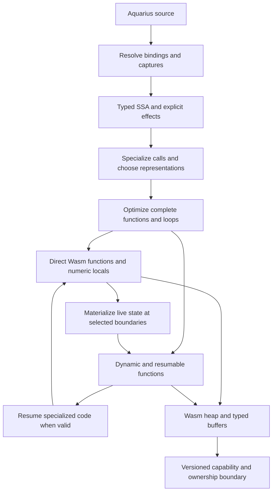

# An architecture for drastic AquariusLang performance improvements

October 14, 2026, Asia/Taipei. This is a proposed design, grounded in the current
compiler/runtime inspection and preserved experiments. It is not an implemented
optimization or a production speedup claim.

The subsequent portable implementation and measured results are documented in
[Portable architecture performance diagnosis](PORTABLE_ARCHITECTURE_RESULTS.md).
That implementation covers scalar representation, guarded direct calls and lexical
binding resolution; the broader SSA, array and continuation design below remains a proposal.

The strategic change is to make runtime costs depend on the dynamism actually
used by a program. Ordinary numerical functions should execute with typed values,
direct calls and ordinary control flow. Captured mutable variables need shared
cells; suspended execution needs continuations; heterogeneous values need dynamic
representation. These decisions should be made by a compiler middle end.

The current architecture starts with named stack operations and emits functions
of the form `aqua_fN(frame) -> continuation`. Almost all language state therefore
remains in runtime scopes, tagged memory operands and explicit frames. Making
that representation cheaper leaves much of its administrative work intact.

## The proposed pipeline

Use a shared semantic IR for both execution paths. Existing generic execution
remains a correctness oracle during implementation and an initial fallback.
The external capability ABI can remain boxed while optimized internal calls use
typed signatures. A new internal calling convention does not require changing
every desktop/browser library at once.

| Architectural decision | Current common representation | Proposed representation |
| --- | --- | --- |
| Ordinary local | Name in a runtime scope | Resolved variable identity and SSA value / Wasm local |
| Captured variable | Retained environment chain | Only the necessary capture fields; shared cells for mutable captures |
| Numeric operation | Tagged operands in memory | Typed operation with explicit Aquarius conversion semantics |
| Known script call | Heap scope/frame plus continuation dispatch | Direct typed Wasm call, with guarded target when needed |
| Suspension | Explicit frame for every call | Materialize live continuation state at an actual suspension boundary |
| Numeric array | 16-byte generic elements | Homogeneous backing storage with a stable array header |
| Temporary allocation | General guest heap allocation | Scalar replacement, stack storage, region or nursery allocation |
| Scheduling check | Helper at each basic block | Compiler-selected safepoints with bounded work between polls |

## 1. Build a language-aware optimizing middle end

Resolve identifiers to declaration identities before emitting runtime operations.
Distinguish parameters, ordinary locals, captures, module globals, dynamic module
members and unresolved host names. A local referenced inside a loop remains the
same resolved local; its lexical scope does not require a runtime dictionary.

Convert control flow to static single assignment form: each computed value has a
definition, uses and a type, with explicit merges at branches and loop backedges.
Mutable captured variables are explicit cell loads/stores, rather than ordinary
SSA values. Conditional declarations and uninitialized paths must remain explicit.

Infer types across calls and recursive call groups to a conservative fixed point.
Useful facts include constants, integer/float/double types, bounded type unions,
array element kind and shape, known function identity, and alias relationships.
Limit specialization variants and widen unstable facts to generic values so code
size and compilation time remain bounded.

Track effects independently: allocation, errors, heap writes, captured/global
mutation, host reentry and suspension. Unknown calls conservatively invalidate
affected assumptions; known scalar host functions can have narrow summaries.
Effects must include transitive callees. Partition a mixed function into optimized
regions so one uncertain capability call does not make its entire numerical loop
use generic execution.

This enables transformations that an operation-by-operation emitter cannot easily
express: interprocedural specialization, inlining, removal of unused temporaries,
constant propagation, safe invariant hoisting, redundant checks elimination and
allocation elimination. Preserve the order of observable side effects and errors.

Julia's [SSA IR](https://docs.julialang.org/en/v1/devdocs/ssair/) and
[type inference](https://docs.julialang.org/en/v1/devdocs/inference/) provide useful
precedents for a language-specific optimizer ahead of a machine-code backend.
Aquarius needs its own semantics, effects and invalidation rules; adopting SSA
alone will not deliver these transformations.

## 2. Choose representations for whole regions

Keep stable scalars in Wasm `i32`, `f32` and `f64` locals across expressions and
loop iterations. Pass them directly to specialized callees and return typed
results. Box at generic boundaries when the receiving code needs a dynamic value.
Small known unions can use separate code paths or tag/payload locals without
forcing every operation through the generic memory stack.

Aquarius integer behavior needs semantic operations in the IR, such as checked
integer addition and its documented out-of-range conversion. Ordinary wrapping
`i32.add` is valid only where a range proof establishes equivalence. Otherwise
lower to checked native arithmetic. Preserve integer division edge cases, float
rounding, promotion and left-type-preserving compound assignment. Reassociation
and aggressive floating-point algebra require a separately defined contract.

For `total += coefficient * src[j]`, a specialized spectral-norm loop should keep
`total`, `coefficient`, `i`, `j` and size in locals, load a double directly from
the array backing store, multiply/add, and advance the loop. It should not push
each intermediate onto a tagged operand stack or search an environment chain.

Use structured Wasm loops/branches in ordinary optimized regions. Continuation
dispatch remains useful at reentry points. Its program counter should not be the
control-flow representation of every ordinary basic block.

## 3. Make suspension pay for continuations

Generate direct typed calls for normal execution, plus entry adapters for dynamic
arguments, generic callers and embedding. Guard mutable function bindings by
identity or binding version. Truly stable internal calls need no repeated global
lookup. Recursive calls can stay direct within a bounded native stack depth.

The difficult part is preserving cooperative yielding and deep recursion. A
function that is synchronous in its language effects can still need to yield for
a browser budget. Merely using direct calls and falling back later cannot recover
the already executed call chain or safely restart side effects.

A portable design is an explicit cold materialization protocol:

1. A selected safepoint detects a yield, a depth limit, or an invalid assumption.
2. The callee writes its live values and continuation identity into a resume record.
3. It returns a status such as `SUSPEND`, instead of a normal value. Callers test
   this status, materialize their own live state and unwind in turn.
4. The scheduler now owns a complete continuation chain, releases control to the
   host when required, and resumes through generated continuation entries.
5. Resumed entries revalidate assumptions and enter specialized regions when valid.

Successful ordinary calls allocate no continuation records. A leaf function proved
bounded and unable to yield can use an even simpler result ABI; other direct calls
pay a status test. Error propagation has a separate status path and retains error
order. Native stack overflow must be prevented by a depth guard before exhaustion.

Materialization maps must describe optimized and inlined frames, live values,
pending arguments and the exact point after already completed effects. Resume
states should come from the semantic IR; they cannot be guessed from a source line.
An entry guard miss can use the generic version immediately. A mid-function miss
needs a valid state reconstruction or a local slow operation that rejoins safely.

For a first prototype, optimize bounded scalar regions and leave uncertain calls
on the current resumable path. Complete state reconstruction before enabling fast
recursive paths for arbitrary depth or yielding. Engine-specific stack switching
can be a later adapter optimization; the portable design should work without it.

## 4. Allocate only the state whose lifetime requires it

Capture analysis should store only free variables actually used by a closure.
Immutable captured values can be copied into compact closure fields. Mutable
captures require shared cells with preserved identity. Per-iteration capture
cells remain distinct when closures escape a loop iteration.

An uncaptured loop's scopes become compile-time structure with zero runtime scope
allocation/reset. Ordinary calls use native locals or execution-owned stack
storage. Escaping closures, retained callbacks and suspended activations still
need durable heap state.

Use escape and lifetime analysis to choose between scalar replacement, stack
storage, short-lived regions and a general heap. Region allocation can free an
entire proved temporary object graph together. Apply it only with ownership proof;
an object returned from a function can still be temporary within a larger caller
region, but a retained alias or callback prevents bulk reclamation.

For unavoidable small heap objects, a bump-allocated nursery and an appropriate
promotion/collection policy can replace repeated general allocator work. A moving
collector requires precise roots, barriers and relocation-safe host ownership.
Implement allocation elimination and precise roots before undertaking a collector
rewrite solely for performance.

Wasm engines do not expose arbitrary Aquarius locals to the custom guest collector.
Generate live-reference maps and compiler-controlled shadow roots at allocating
calls and collection safepoints. Numeric-only locals need no roots. Keep host
handles stable and pin or borrow exposed storage under explicit lifetime rules.
LLVM's [GC safepoint design](https://llvm.org/docs/Statepoints.html) is useful
background for live-value bookkeeping, rather than a requirement to use LLVM.

## 5. Design collections and library calls for typed computation

Represent array identity with a stable header and a selectable backing kind:
integer, float, double, reference, or generic values. Preserve aliases when a
generic array widens its backing representation. Preserve independent `push`
snapshots through copy-on-write. Optional explicitly typed buffers can promise
stable element type and define what incompatible writes do.

Specialize a kernel on element kind, shape and ownership. Hoist those guards to
entry or a safe region boundary. Eliminate bounds checks only with a proof of
index range and stable length. An unknown callback, resize or aliasing write can
invalidate a hoisted assumption. Generic out-of-range reads still return null.

Add fixed-layout records and known-field offsets for common object shapes, while
keeping dynamic hashes available. Use indexed hashes for genuinely dynamic keys.
These capabilities matter beyond the numerical suite: parsers, model loaders,
game state and data transformations should not depend on linear member searches.

The same typed buffer/ownership ABI should serve core libraries, desktop hosts and
browser adapters. Bulk operations can then use SIMD, cache blocking, parallel
kernels or GPU work where appropriate without copying/tagging every element at
each call. They complement a fast scalar compiler; their crossover costs and
numeric contracts need separate benchmarks.

## 6. Add speculative specialization after the static foundation

Ahead-of-time inference will cover many scripts but not arbitrary dynamic usage.
Record call-site types, function identities and array shapes in generic execution.
Use a bounded number of specialized versions for frequently observed patterns,
with guards and correct fallback. Track dependencies per affected binding or object
shape, instead of invalidating every optimized function on unrelated scope edits.

Start with build-time profile-guided specialization or a small set of AOT variants.
Runtime Wasm generation and tiering can follow when real applications demonstrate
that static coverage is insufficient. On-stack replacement needs the same state
maps as deoptimization. The compiler must cap compilation effort, variant count
and generated code size.

[V8's optimizer documentation](https://v8.dev/docs/turbofan) illustrates the broader
combination of graph optimization, inlining, context specialization and deoptimization.
This design borrows those principles without assuming Aquarius needs V8's exact IR
or that a particular JIT implementation will reproduce V8 performance.

## Architectural alternatives and their tradeoffs

| Direction | Potential benefit | Tradeoff | Recommendation |
| --- | --- | --- | --- |
| Typed optimizing IR targeting Wasm | Removes generic call/value/scope costs while retaining one portable artifact | Major compiler work, especially state maps and semantic proofs | Primary architecture |
| Optional sealed compute functions/modules | Explicit type/effect/global-stability contracts reduce speculation and give predictable kernels | Introduces a restricted contract; arbitrary dynamic features need a boundary | Useful early route and durable language feature |
| Runtime specialization / JIT tier | Adapts to types unavailable at build time | Warmup, compilation budgets, invalidation and code size | Add when AOT coverage is measured |
| Native LLVM/Cranelift backend | Additional native optimization and platform integration options | A second backend/toolchain and deployment surface | Consider after a reusable typed IR exists |
| Full static-language redesign | Stronger proofs, typed generics and explicit async can simplify optimization considerably | Source and API compatibility changes | Product choice, not required for the initial architecture |

An optional compute contract can allow typed parameters/captures, stable buffer
element types and declared effects. The compiler checks the contract and reports
why code cannot enter the optimized region. It should work with inference in
ordinary code, rather than requiring users to annotate every arithmetic expression.
Explicit async boundaries and sealed bindings can provide additional guarantees
if the language is deliberately willing to add those concepts.

A native backend becomes useful when it consumes optimized semantic IR. Changing
the backend while emitting the same generic scope/frame/value operations retains
their costs. Similarly, packing a dynamic value into fewer bytes, choosing Wasm GC,
or changing the runtime implementation language is insufficient on its own.

## Why an order-of-magnitude improvement is a credible research direction

The preserved October 13 feasibility experiment used hand-written typed Wasm with
the same naive algorithms, without memoization or cached results:

| Bounded kernel | Typed Wasm ms | Python baseline ms | Python/typed |
| --- | ---: | ---: | ---: |
| Fibonacci(28) | 1.463 | 26.442 | 18.07× |
| Collatz(10000) | 1.220 | 83.408 | 68.37× |

See [typed probe analysis](../results/python-parity/20261013/analysis.json),
[raw measurements](../results/python-parity/20261013/warm-profile.json), and
[probe implementation](python-parity-profile/make_typed_probes.py).

These probes omit general type/binding behavior, overflow outside the bounded
inputs, cancellation, collection and suspension. They establish backend headroom;
they do not predict the speed of a fully compatible Aquarius compiler. The current
production diagnosis's 1.5–1.6× helper-inlining gain removes only a subset of the
overhead that this architecture addresses.

## A staged program with concrete acceptance criteria

| Stage | Deliverable | What must be demonstrated |
| --- | --- | --- |
| 1 | Resolved semantic IR, effects and typed scalar code generation | Actual Aquarius source produces locals/arithmetic and ordinary branches; no name lookup or tagged operand stack in selected kernels |
| 2 | Bounded typed direct calls, adapters and capture analysis | Fibonacci uses no heap frame/scope per successful fast call; entry fallback handles regions exceeding the supported depth/work budget; closures and rebinding retain behavior |
| 3 | State maps, cold continuation materialization and precise roots | Repeated suspension/resume, cancellation, callback mutation and errors work without replaying effects or losing live references |
| 4 | Specialized array backing/indexing and lifetime-aware allocation | Spectral norm/matrix use raw numeric loads in hot loops; arrays widen and snapshots retain semantics; object workloads allocate substantially less |
| 5 | Profile-driven variants and bulk typed library ABI | Real workloads gain when static inference misses; code size, compile latency and crossing costs stay bounded |

The first vertical slice should compile Fibonacci and Collatz from ordinary Aquarius
source through the new IR, preserving their algorithms. A **5× improvement over the
current Aquarius implementation** is a useful prototype acceptance target, not a
predicted result. Measure multiple input sizes, cold and warm execution, and both
desktop and browser behavior. Follow with spectral norm to test calls plus arrays,
and trees to test allocation and reference liveness.

Use current generic execution for differential semantic tests, including numeric
edge cases, eager booleans, captured loop variables, aliasing/snapshots, rebinding,
deep recursion, cancellation and native reentry. Add generated-code checks and
allocation/call counters so a fast benchmark cannot hide missing optimized coverage.
Set separate bounds for compilation/code growth and responsiveness.

This plan changes the structure of the compiler and execution model. Its purpose
is to make whole categories of runtime work disappear from common compute paths.
